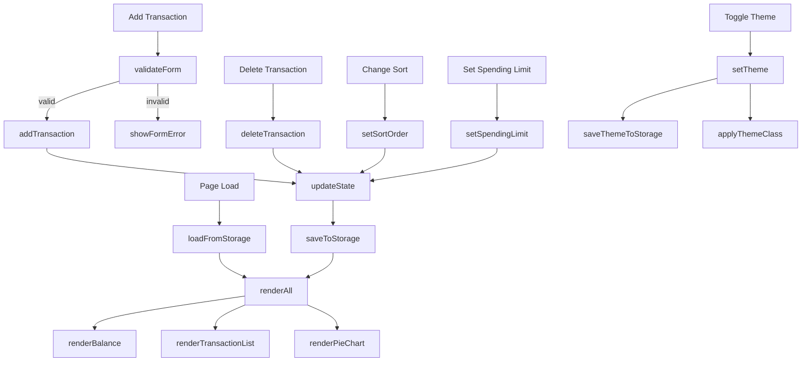

# Design Document

## Overview

The Expense & Budget Visualizer is a single-page, static web application built with vanilla HTML, CSS, and JavaScript. It runs entirely in the browser with no backend: all state lives in `localStorage`. The application renders four sections top to bottom — Total Balance, Input Form, Pie Chart, Transaction List — and provides optional features for transaction sorting, a spending-limit warning, and a dark/light theme toggle.

**Key design decisions:**

- **No frameworks.** All DOM manipulation, event handling, and state management use plain JavaScript (ES6+). This eliminates build steps and makes the project deployable to GitHub Pages by simply pushing the repository.
- **Chart.js via CDN.** Pie chart rendering delegates to [Chart.js](https://chartjs.org/) loaded from `https://cdn.jsdelivr.net/npm/chart.js`, the library's official recommended CDN. The script tag is placed just before `</body>` so the DOM is ready before `js/script.js` runs.
- **Single source of truth.** A module-level `state` object in `js/script.js` holds the canonical list of transactions, the current sort order, the spending limit, and the active theme. Every user action updates `state` first, then re-renders the UI, then persists to `localStorage`.
- **No test framework.** Testing is out of scope per the project constraints.

---

## Architecture

The application follows a **unidirectional data flow**:

```
User Action → updateState() → persist() → render()
```

All logic lives in `js/script.js`. There are no modules or imports — the file exposes nothing to global scope except what `index.html` event handlers need via `data-` attributes and direct function references.

### File Layout

```
project-root/
├── index.html          ← single HTML file; loads CDN script and js/script.js
├── css/
│   └── style.css       ← all styling, CSS custom properties for theming
└── js/
    └── script.js       ← all application logic
```

### High-Level Flow



---

## Components and Interfaces

All components are plain HTML elements wired to JavaScript functions. There are no custom element classes.

### index.html Structure

```html
<body data-theme="light">
  <header>
    <!-- Theme toggle button -->
  </header>

  <!-- Section 1: Total Balance -->
  <section id="balance-section">
    <h2 id="total-balance">$0.00</h2>
    <!-- Spending limit input -->
  </section>

  <!-- Section 2: Input Form -->
  <section id="form-section">
    <form id="transaction-form">
      <input id="item-name" type="text" required />
      <input id="item-amount" type="number" step="0.01" min="0.01" required />
      <select id="item-category">
        <option value="Food">Food</option>
        <option value="Transport">Transport</option>
        <option value="Fun">Fun</option>
      </select>
      <button type="submit">Add</button>
    </form>
    <div id="form-error" role="alert" aria-live="polite"></div>
  </section>

  <!-- Section 3: Pie Chart -->
  <section id="chart-section">
    <canvas id="spending-chart"></canvas>
    <p id="empty-state">No transactions yet.</p>
  </section>

  <!-- Section 4: Transaction List -->
  <section id="list-section">
    <select id="sort-control">
      <option value="default">Default</option>
      <option value="amount-asc">Amount (Low to High)</option>
      <option value="amount-desc">Amount (High to Low)</option>
      <option value="category-alpha">Category (Alphabetical)</option>
    </select>
    <ul id="transaction-list"></ul>
  </section>

  <script src="https://cdn.jsdelivr.net/npm/chart.js"></script>
  <script src="js/script.js"></script>
</body>
```

### JavaScript Public Interface (functions called from HTML or internally)

| Function | Signature | Description |
|---|---|---|
| `init` | `() → void` | Entry point; called on `DOMContentLoaded`. Loads state and renders. |
| `handleFormSubmit` | `(event) → void` | Validates and adds a transaction. |
| `handleDelete` | `(id) → void` | Removes transaction by id. |
| `handleSortChange` | `(value) → void` | Updates sort order and re-renders list. |
| `handleSpendingLimitChange` | `(value) → void` | Updates limit, persists, re-renders balance. |
| `handleThemeToggle` | `() → void` | Flips theme between `'light'` and `'dark'`. |
| `renderAll` | `() → void` | Calls all render functions in order. |
| `renderBalance` | `() → void` | Updates total balance text and limit-exceeded highlight. |
| `renderTransactionList` | `() → void` | Rebuilds the `<ul>` with sorted transactions. |
| `renderPieChart` | `() → void` | Destroys old Chart.js instance (if any) and creates a new one; shows empty state if no transactions. |

---

## Data Models

### Transaction Object

```js
{
  id: string,         // crypto.randomUUID() or Date.now().toString() fallback
  name: string,       // item description; trimmed, non-empty
  amount: number,     // positive float, two decimal places on display
  category: string,   // "Food" | "Transport" | "Fun"
  createdAt: number   // Date.now() timestamp for chronological sort
}
```

### Application State Object

```js
{
  transactions: Transaction[],  // all recorded transactions, insertion order
  sortOrder: string,            // "default" | "amount-asc" | "amount-desc" | "category-alpha"
  spendingLimit: number | null, // null means no limit set
  theme: string                 // "light" | "dark"
}
```

### localStorage Keys

| Key | Value | Description |
|---|---|---|
| `ebv_transactions` | `JSON.stringify(Transaction[])` | All transactions |
| `ebv_spending_limit` | `JSON.stringify(number)` or `"null"` | Current spending limit |
| `ebv_theme` | `"light"` or `"dark"` | Active theme preference |

The sort order is **not** persisted — it resets to `"default"` on page load per requirements.

### Category Colour Map

```js
const CATEGORY_COLORS = {
  Food:      '#FF6384',
  Transport: '#36A2EB',
  Fun:       '#FFCE56'
};
```

---

## Correctness Properties

*A property is a characteristic or behavior that should hold true across all valid executions of a system — essentially, a formal statement about what the system should do. Properties serve as the bridge between human-readable specifications and machine-verifiable correctness guarantees.*

### Property 1: Transaction addition grows the list by one

*For any* valid transaction (non-empty name, positive numeric amount, valid category), adding it to the transaction list must increase the list length by exactly one and the new transaction must appear in the list.

**Validates: Requirements 1.2**

### Property 2: Invalid inputs are rejected and leave state unchanged

*For any* string composed entirely of whitespace characters submitted as the item name, or any non-positive / non-numeric value submitted as the amount, the form submission must be rejected, an error message must be shown, and the transaction list must remain unchanged.

**Validates: Requirements 1.3, 1.5**

### Property 3: Successful submission clears the input form

*For any* valid transaction submission, all form fields (item name, amount, category) must be empty immediately after the transaction is added.

**Validates: Requirements 1.4**

### Property 4: Transaction render completeness

*For any* transaction in the list, the rendered list item must display the item name, the amount, the category, and a delete button.

**Validates: Requirements 2.2, 2.3**

### Property 5: Transaction deletion removes exactly the target item

*For any* transaction list with at least one item, deleting a transaction by its id must decrease the list length by exactly one and must remove precisely the transaction with that id while leaving all others intact.

**Validates: Requirements 2.4**

### Property 6: Total balance equals the sum of all transaction amounts

*For any* set of transactions, the computed Total Balance must equal the arithmetic sum of all transaction amounts and must be formatted as a string with exactly two decimal places.

**Validates: Requirements 3.2, 3.3, 3.4**

### Property 7: Pie chart category percentages sum to 100

*For any* non-empty transaction list, the category percentage values used to draw the Pie Chart must each equal `(category_total / total_balance) × 100` and their sum must equal 100 within floating-point tolerance.

**Validates: Requirements 4.6**

### Property 8: LocalStorage round-trip preserves all transaction data

*For any* list of transactions, serializing to `localStorage` and then deserializing must produce a list that is structurally equivalent — same number of items, same ids, names, amounts, categories, and timestamps in the same order.

**Validates: Requirements 5.1, 5.2, 5.3**

### Property 9: Amount sort invariants

*For any* transaction list sorted by "Amount (Low to High)", every adjacent pair must satisfy `amount[i] ≤ amount[i+1]`. Conversely, *for any* transaction list sorted by "Amount (High to Low)", every adjacent pair must satisfy `amount[i] ≥ amount[i+1]`.

**Validates: Requirements 6.2, 6.3**

### Property 10: Category-alphabetical sort is lexicographically ordered

*For any* transaction list sorted by "Category (Alphabetical)", every adjacent pair must satisfy `category[i] ≤ category[i+1]` (case-insensitive lexicographic comparison).

**Validates: Requirements 6.4**

### Property 11: Spending limit highlight correctness

*For any* combination of transaction list and spending limit: when the Total Balance exceeds the spending limit, the balance element must carry the over-limit CSS highlight class; when the Total Balance is at or below the limit, the highlight class must be absent.

**Validates: Requirements 7.4, 7.5, 7.6**

### Property 12: Spending limit and theme persistence round-trips

*For any* numeric spending limit value, saving it to `localStorage` and reading it back must yield the identical numeric value. *For any* theme value (`"light"` or `"dark"`), saving it to `localStorage` and reading it back must yield the identical string and cause it to be applied to the document root.

**Validates: Requirements 7.2, 7.3, 8.3, 8.4**

---

## Error Handling

### Form Validation Errors

Validation runs on form submit before any state mutation.

| Condition | Error message shown |
|---|---|
| Item Name is empty or whitespace | "Item name is required." |
| Amount is empty | "Amount is required." |
| Amount is zero or negative | "Amount must be a positive number." |
| Amount is non-numeric (NaN) | "Amount must be a valid number." |

Errors display in `#form-error` with `role="alert"` so screen readers announce them. The error clears on the next successful submission.

### LocalStorage Errors

`localStorage` access is wrapped in try/catch. If `localStorage` is unavailable (e.g. private browsing quota exceeded), the application falls back to in-memory state only and displays a one-time banner: "Storage unavailable — data will not be saved."

### Chart Rendering

Before creating a new `Chart` instance, the code checks whether an existing instance is attached to the canvas and calls `.destroy()` on it. This prevents the "Canvas is already in use" error from Chart.js when re-rendering on transaction changes.

If Chart.js fails to load from CDN (network error), the `<canvas>` section is hidden and replaced with the message: "Chart unavailable — could not load charting library."

### Spending Limit Input

A non-numeric or negative spending limit value is silently ignored; the previous valid value is retained. An empty input clears the limit (`null`).

---

## Testing Strategy

> This project has no test framework per requirements. The correctness properties above document the intended behavioral invariants and serve as a manual testing checklist during development.

### Manual Testing Checklist

Derived from the Correctness Properties and acceptance criteria:

**Transaction Input (Req 1)**
- [ ] Add a transaction with all three fields filled → item appears in list, balance updates, form clears.
- [ ] Submit with empty name → error shown, list unchanged.
- [ ] Submit with whitespace-only name → error shown, list unchanged.
- [ ] Submit with empty amount → error shown.
- [ ] Submit with amount = 0 or negative → error shown.
- [ ] Submit with non-numeric amount → error shown (browser `type="number"` also prevents this).

**Transaction Display and Deletion (Req 2)**
- [ ] Each item shows name, amount, category, and a delete button.
- [ ] Clicking delete removes the item and updates balance and chart within 100 ms.

**Balance Calculation (Req 3)**
- [ ] Balance equals exact sum of all amounts, formatted to two decimal places.
- [ ] Add several transactions and verify arithmetic manually.
- [ ] Delete a transaction and verify balance recalculates.

**Pie Chart (Req 4)**
- [ ] With transactions: pie chart renders with correct segments.
- [ ] Percentage for each segment = category total / Total Balance × 100 (verify with 2–3 manual calculations).
- [ ] With zero transactions: empty state message is shown, canvas is hidden.

**Data Persistence (Req 5)**
- [ ] Add transactions, reload page → transactions still present.
- [ ] Delete a transaction, reload → transaction absent.
- [ ] Fresh profile / cleared storage → list is empty on load.

**Sorting (Req 6)**
- [ ] Amount Low→High: each adjacent pair in ascending order.
- [ ] Amount High→Low: each adjacent pair in descending order.
- [ ] Category Alphabetical: sorted by category name A–Z.
- [ ] Default: original insertion order (most recent first).

**Spending Limit (Req 7)**
- [ ] Set limit below current balance → balance and over-limit transactions highlighted.
- [ ] Delete transactions until balance ≤ limit → highlight removed.
- [ ] Reload page → limit value restored.

**Theme (Req 8)**
- [ ] Toggle switches between dark and light; all elements update within 100 ms.
- [ ] Reload page → saved theme applied immediately.
- [ ] No saved theme → defaults to light mode.

**Responsive Layout (Req 9)**
- [ ] Mobile (< 768 px): single column, all four sections visible top-to-bottom.
- [ ] Desktop (≥ 768 px): optimised multi-column layout.
- [ ] All buttons and inputs ≥ 44 px tall.

**Performance (Req 10)**
- [ ] Add 1000 transactions via browser console loop; verify UI remains responsive.
- [ ] Initial load time < 2 s on broadband.
